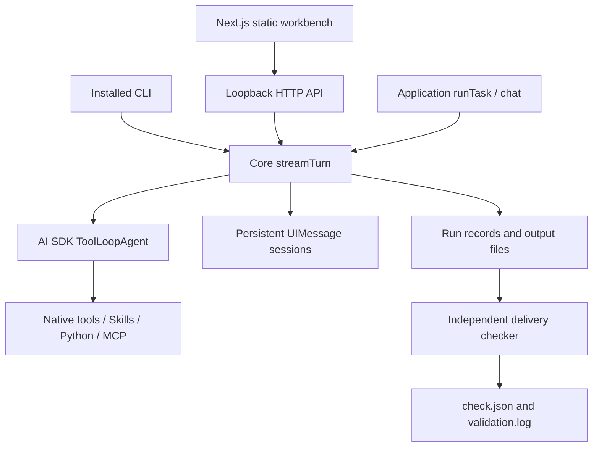

# Architecture and source map

Core is the execution/delivery layer; AI SDK owns the model/tool loop and native message protocol. The Next.js app exports static files bundled with the npm package. The installed Node backend serves those files and the only execution API. There is no separate Next.js execution server.

## Source responsibilities

| Path | Responsibility |
| --- | --- |
| packages/core/src/index.ts | Public package exports |
| packages/core/src/types.ts | Configuration, sessions, runs, check and streaming contracts |
| packages/core/src/config.ts | Typed config, trusted config loading, .env and project instructions |
| packages/core/src/models.ts | Explicit environment credentials and AI SDK provider registry |
| packages/core/src/agent.ts | Native Agent construction, shared streaming lifecycle, context projection, interruption records, cancellation and task/chat adapters |
| packages/core/src/session.ts | Persistent full UIMessage history and session state |
| packages/core/src/storage.ts | Atomic records, IDs, project lock and interrupted-process recovery |
| packages/core/src/workspace.ts | Canonical path confinement and protected internal metadata |
| packages/core/src/skills.ts | Metadata discovery and progressive full-Skill loading |
| packages/core/src/tools.ts | Native file/Skill/Python tools and output/cancellation bounds |
| packages/core/src/process.ts | Shell-free subprocess execution, bounded output and process-group cancellation |
| packages/core/src/mcp.ts | Native MCP connections, tool namespacing and cleanup |
| packages/core/src/delivery.ts | Independent check execution, report validation and rechecking |
| packages/core/src/provenance.ts | Streamed source/artifact SHA256, version/config/validator baselines and comparison |
| packages/core/src/files.ts | Explicit bounded input imports, safe raster/text/CSV previews and artifact handles |
| packages/core/src/diagnostics.ts | Static native tool schema inspection and explicit environment/connectivity diagnosis |
| packages/core/src/http.ts | Authenticated API, native SSE, artifacts and static assets |
| packages/core/src/cli.ts | CLI adapters for the same Agent lifecycle |
| packages/core/src/create.ts | Project scaffolding entry point |
| packages/core/src/scaffold.ts | Copy the installed minimal template into an empty project |
| packages/core/templates/minimal/ | Installable Python-first starter with Skill and independent validator |
| packages/core/templates/basic/ | Native TypeScript tool starter with cooperative cancellation |
| packages/core/templates/python/ | Python-first starter with independent source-based validator |
| apps/workbench/ | Next.js static client using native useChat and DefaultChatTransport |
| apps/workbench/app/layout.tsx | Document metadata, theme initialization and shared page shell |
| apps/workbench/app/page.tsx | Static page entry |
| apps/workbench/app/workbench.tsx | Project/session state, native transport, task/chat submission and cancellation |
| apps/workbench/app/globals.css | Responsive layout, interaction states and light/dark styles |
| apps/workbench/app/icon.svg | Editable application icon |
| apps/workbench/components/conversation.tsx | Conversation display and message rendering |
| apps/workbench/components/message.tsx | Text, reasoning and native tool argument/result/error parts |
| apps/workbench/components/run-panel.tsx | Execution/delivery status, check report, recheck and artifacts |
| apps/workbench/components/input-files.tsx | Explicit input import and insertion of paths into the composer |
| apps/workbench/components/artifact-preview.tsx | Escaped text/Markdown, bounded tables and authenticated raster preview |
| apps/workbench/components/capabilities.tsx | Read-only native model/Skill/tool/MCP/file-policy inspection |
| apps/workbench/components/run-evidence.tsx | Original/latest check observations and provenance baselines |
| apps/workbench/lib/api.ts | Bootstrap credential, authenticated API requests and response errors |
| scripts/bundle-web.mjs | Copy built static assets into the distributable package |
| scripts/demo.mjs | Labeled deterministic model fixture plus persistent local demo project |
| scripts/prepare-package.mjs | Validate built assets and copy root documentation/license/examples into npm package |
| scripts/pack-core.mjs | Create the local installable release-candidate tarball |
| scripts/compare-pi.mjs | Optional matched two-application comparison against an existing Pi build |
| scripts/live-smoke.mjs | Explicit opt-in real-provider smoke; never substitutes a fixture for missing credentials |
| scripts/tui-smoke.py | Real POSIX terminal driver for the official TUI integration test |
| scripts/check-docs.mjs | Check local documentation links and required lifecycle/evidence language |
| tests/fixtures/model-server.mjs | Real HTTP streaming/nonstreaming OpenAI-compatible deterministic fixture |
| tests/fixtures/mcp-server.mjs | Real local stdio MCP fixture |
| tests/consumers/installed.test.mjs | npm-packed external install, Python apps, session continuation and served UI |
| tests/resources.test.mjs | Resource, path, Skill, subprocess, model and MCP contract tests |
| tests/lifecycle.test.mjs | Full tasks, durable tool histories, actual worker crash, HTTP and ten-turn context behavior |
| tests/delivery.test.mjs | Checker states, stale reports, partial CLI exit code and timeouts |
| tests/review.test.mjs | Independently reproduced concurrency, cleanup, report integrity and error-mapping regressions |
| tests/access.test.mjs | Sensitive aliases, current-run policy, restricted reads and noncooperative native cancellation |
| tests/provenance.test.mjs | Original evidence, rechecks, tampering, legacy records and actual killed-checker-worker recovery |
| tests/files.test.mjs | Upload authorization/type/size/path boundaries and bounded safe previews |
| tests/onboarding.test.mjs | Project environment isolation, offline inspect, diagnostics and installed templates |
| tests/tui.test.mjs | Official terminal UI through the shared authenticated session path |
| tests/browser.spec.ts | Compiled browser interaction checks |
| examples/sequence-summary/ | FASTA source-preserving analysis, Skill, checker and Python driver |
| examples/table-quality/ | CSV source-preserving profile, Skill, checker and Python driver |
| examples/advanced/ | Native delegation and explicit two-Agent workflow |

## Request and persistence path

The browser sends UI messages with only its newest user message accepted; Core reloads prior history from server storage. streamTurn opens a session/run, invokes the native Agent and consumes its UI stream. The UI receives a parallel stream. Task completion records artifacts and runs the configured checker. Session history is persisted for CLI/browser reuse. A broken browser connection does not own task cancellation. Explicit cancel aborts both the model and registered subprocess work.

Execution status and delivery status are separate fields. Check results are independent observations, not model-generated status. Complete tool evidence is stored before future model input is projected and bounded. Project locks coordinate CLI and HTTP instances. A recover operation diagnoses dead ownership, records interruption and preserves evidence without replaying a tool call.

See [implementation contracts](CONTRACTS.md) for API route shapes and [Conventions](CONVENTIONS.md) for status and trust boundaries.
