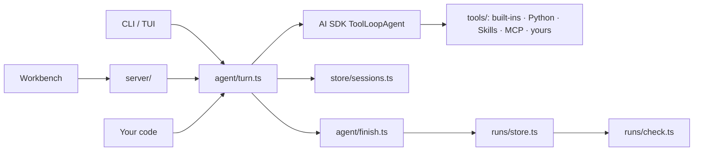

# Architecture

Core is the execution and delivery layer. The AI SDK owns the model/tool loop and the message protocol; Core adds sessions, runs, checks, safety boundaries and one local HTTP server. The Next.js workbench is a static export served by that server; there is no second execution server.



## Life of a task turn

1. `agent/turn.ts` validates the request, then `agent/gate.ts` takes the in-process gate and the project lock (`store/lock.ts`).
2. Crash leftovers are recovered (`agent/recovery.ts`); the session is loaded and checked against current tool schemas.
3. For a task, `runs/store.ts` creates `runs/<id>/` and `runs/provenance.ts` freezes the inputs, code and Skill fingerprints.
4. The user message is saved. If the model's view would reach the compaction threshold, older turns are summarized into `session.summary` (`agent/compact.ts`). The native stream starts with Core's bounded context (`agent/prompt.ts`); the memory index is appended to the latest user message of each segment, never stored.
5. The stream is split in two: the UI gets a detachable copy, and `agent/finish.ts` consumes the other to persist history.
6. When the stream ends, `finish.ts` waits for tools to settle, then takes one of three exits:
   - a tool call needs approval (`agent/approval.ts`): the run and session become `awaiting_approval` and the lock is released. `respondTurn` later continues the same assistant message and run;
   - steering text is still queued (`agent/steering.ts`): it is appended as a user message and another stream starts on the same lock;
   - otherwise the run's terminal state is recorded and the check runs (`runs/check.ts`). With `repairAttempts`, a failed or partial check appends a repair message and streams again.
7. Session usage is added up, steering parts are split into user messages, and the lock is released.

One turn can therefore hold several native streams ("segments"), all under one lock, one timeout and one run. Only the first is streamed to the UI; the workbench restores later segments from the saved session.

## Layers

Imports only point downward. Each layer can be read and tested without the ones above it.

```
cli/  server/          entry points: command table, loopback HTTP + workbench
agent/                 turn lifecycle: gate → turn → finish, recovery, prompt
tools/   runs/         model tools (built-ins, Python, Skills, MCP) · run records, provenance, checks
config/                defineAgent, .env, modelFromEnv
workspace/             the model's file view, execution context, subprocesses
store/                 atomic JSON, project lock, sessions, hashing
```

A browsable version with the turn sequence and storage layout is in [architecture.html](architecture.html); [framework.html](framework.html) is a Chinese teaching diagram of the whole framework.

## Source map

| Path | Responsibility |
| --- | --- |
| `src/index.ts` | Public exports |
| `src/types.ts` | Config, session, run, check and turn types |
| `src/errors.ts` | Error classes (map to HTTP status) and credential redaction |
| `config/load.ts` | `defineAgent` validation, `limitsOf`, `.env` loading, config import, instructions |
| `config/models.ts` | `modelFromEnv`, `modelInfo`, `modelChoices`, `selectModel`, usage and cost arithmetic |
| `agent/create.ts` | `createAgent`: the public facade |
| `agent/resources.ts` | Builds workspace, Skills, MCP, tools and the native `ToolLoopAgent` (approval, retries, tool-name repair, budget stop, steering and bounding in `prepareStep`) |
| `agent/gate.ts` | One operation at a time: starting → running → released; cancel and close |
| `agent/turn.ts` | Accept a turn (`streamTurn`), continue one after approval (`respondTurn`), queue steering (`steerTurn`), start segments |
| `agent/finish.ts` | Per segment: persist, settle tools; then pause, follow up, or record the run, check, repair, release |
| `agent/prompt.ts` | System rules, task delivery note, bounded context projection |
| `agent/recovery.ts` | Mark interrupted work after a crash (paused approvals are left alone) |
| `agent/approval.ts` | Approval matcher, pending calls, applying decisions to stored parts |
| `agent/switches.ts` | Project tool switches (disabled, alwaysAllow) read at call time; `updateToolSwitch` under the lock |
| `agent/attachments.ts` | Image/PDF attachment parts (`project:` references), inlining per model call, context size without file bytes |
| `agent/steering.ts` | Steering queue: prepareStep injection, `data-steer` announcements, splitting into user messages |
| `agent/compact.ts` | When to summarize, writing `session.summary`, the summarized model view |
| `agent/subagent.ts` | `runSubagent`: helper tool sets and a native `ToolLoopAgent` per call |
| `agent/steps.ts` | `StepRecord`s and usage/cost totals for runs and sessions |
| `agent/eval.ts` | `loadEvalFile`, `runEvals`: run cases and grade them with the checker |
| `agent/mcp.ts` | List, test, add and remove project HTTP MCP servers; hot-swap the tool set |
| `tools/index.ts` | Assemble and name-check the tool set |
| `tools/guard.ts` | Cancel-signal merging, output bounds, in-flight tracking |
| `tools/builtin.ts` | `readFile`, `writeFile`, `listFiles`, `loadSkill`, `updatePlan`, `readToolOutput` |
| `tools/search.ts` | `findFiles` and `searchFiles`: recursive walks through the Workspace policy |
| `tools/memory.ts` | `saveMemory`, `readMemory`, `forgetMemory`, memory rules and the per-turn index note |
| `tools/python.ts` | `runPython` and mode policy |
| `tools/skills.ts` | Skill discovery, verified loading, fingerprints |
| `tools/mcp.ts` | MCP connections, tool namespacing, cleanup |
| `tools/describe.ts` | Tool name/description/JSON schema listing |
| `workspace/workspace.ts` | The model's file view: confinement, secret hiding, write policy |
| `workspace/context.ts` | Per-turn `ExecutionContext` (AsyncLocalStorage) |
| `workspace/process.ts` | Shell-free subprocesses with bounded output and process-group kill |
| `store/files.ts` | Symlink-free metadata paths, atomic writes, IDs, `ifExists` |
| `store/hash.ts` | `sha256` and streaming `hashFile`, shared by Skills, uploads and provenance |
| `store/lock.ts` | Cross-process project lock with dead-owner recovery |
| `store/sessions.ts` | Session records |
| `store/memory.ts` | `.lab-agent/memory/<name>.md` entries: parse, list, save, forget |
| `store/mcp.ts` | `.lab-agent/mcp.json` and merging with config MCP |
| `store/tools.ts` | `.lab-agent/tools.json` tool switches |
| `runs/store.ts` | Run records, artifact listing, check report schema |
| `runs/provenance.ts` | Streaming SHA-256, input freezing, change detection |
| `runs/check.ts` | Preflight → checker → final integrity; interrupted checks |
| `server/http.ts` | Loopback Node server and response streaming |
| `server/routes.ts` | Origin/token guard, API route table, static assets |
| `server/files.ts` | Uploads, artifact access, bounded previews |
| `cli/main.ts` | `lab-agent` command table, including `approve` and `eval` |
| `cli/doctor.ts` | `inspect` and `doctor` |
| `cli/scaffold.ts`, `cli/create.ts` | Templates and `create-lab-agent` |
| `templates/basic`, `templates/python` | Installable starters |

Workbench (`apps/workbench`, Next.js static export, Tailwind CSS v4, shadcn-style components on Radix):

| Path | Responsibility |
| --- | --- |
| `app/workbench.tsx` | Bootstrap token, poll state, select sessions, three-pane shell and top bar |
| `app/globals.css` | Neutral design tokens; `ui.accent` sets `--brand`, used only for primary buttons and the focus ring |
| `components/brand.tsx` | Monochrome monogram from `ui.title` (mobile header) |
| `components/sidebar.tsx` | Sessions, project, input files, capabilities entry |
| `components/conversation.tsx` | `useChat` transport (new turns and approval responses), history restore, cancel, steering, plan panel, compaction |
| `components/composer.tsx` | Message box, Task/Chat switch, model picker, context meter with Compact, task input bindings, attachment chips, send-to-running-turn |
| `components/message.tsx`, `markdown.tsx` | Messages, agent step timeline (tool calls, reasoning), Approve/Always allow/Deny, plan checklist, helper answers, steering and repair notes, safe Markdown |
| `components/run-panel.tsx`, `run-evidence.tsx`, `status.tsx` | Runs, Execute → Check → Deliver progress, model calls, cost, repairs, checks, outputs, provenance |
| `components/capabilities.tsx`, `skills.tsx`, `memory.tsx`, `tool-switches.tsx`, `mcp-servers.tsx` | Models, limits and prices, expandable Skills, project memory (read, forget), tools with Enabled/Always allow switches, helpers and compaction, MCP add/test/remove |
| `components/artifact-preview.tsx`, `input-files.tsx` | Preview dialog and uploads |
| `components/ui/*` | Button, Badge, Dialog primitives |
| `lib/api.ts`, `lib/branding.ts` | Authenticated API calls; applying `ui` config |

Stable CSS hooks used by tests and custom themes: `.message-user`, `.message-assistant`, `.message-repair`, `.tool-call`, `.tool-body`, `.tool-approval`, `.approval-actions`, `.plan-panel`, `.steer-note`, `.steer-status`, `.compaction-note`, `.memory-list`, `.model-calls`, `.session-usage`, `.task-inputs`, `.task-input-body`, `.chat-policy`, `.input-files`, `.capability-list`, `.skill-fingerprints`, `.connection-banner`.

## Invariants

- Full history on disk; only the model's view is bounded. A summary replaces older turns in the view, never in history.
- A paused approval is not terminal and never recovered as a crash; only the server's own pending calls can be answered.
- All segments of a turn (approval continuation aside) share one lock, one timeout and one run.
- Execution and delivery are separate fields; only a checker sets delivery.
- Every accepted operation ends with a terminal record, including after a crash.
- The lock is held until tool processes have settled, never released early on abort.
- Tools are never replayed after recovery.
- Model file tools, including search, never see secrets or Core metadata; memory is reached only through the memory tools. Host code is trusted, not sandboxed.

## Tests

| Path | Covers |
| --- | --- |
| `tests/fixtures/model-server.mjs` | Deterministic OpenAI-compatible HTTP model (labeled fixture) |
| `tests/fixtures/mcp-server.mjs` | Real stdio MCP server |
| `tests/resources.test.mjs`, `access.test.mjs` | Workspace policy, subprocesses, Skills, tools, MCP |
| `tests/lifecycle.test.mjs`, `review.test.mjs` | Full turns, cancel, crash recovery, HTTP, concurrency |
| `tests/delivery.test.mjs`, `provenance.test.mjs` | Checker outcomes, rechecks, tampering, legacy records |
| `tests/task-inputs.test.mjs`, `skills-policy.test.mjs`, `session-compatibility.test.mjs` | Input freezing, Skill fingerprints, schema drift |
| `tests/files.test.mjs` | Upload and preview boundaries |
| `tests/workbench-features.test.mjs`, `fixtures/mcp-http-server.mjs` | Model choice, context metadata, Skill reading, project HTTP MCP |
| `tests/memory-search.test.mjs` | `findFiles`/`searchFiles` policy and limits; memory save, index, provenance, routes, `memory: false`, helpers |
| `tests/core-upgrades.test.mjs` | Tool switches, parallel helpers, image/PDF attachments and uploads, environment provenance |
| `tests/harness.test.mjs` | Approval, retries, tool-name repair, compaction, `readToolOutput`, repair loop, helpers, plan, steering, telemetry and budgets, evals, HTTP routes |
| `tests/onboarding.test.mjs`, `consumers/installed.test.mjs` | Templates and the packed tarball outside the repo |
| `tests/tui.test.mjs`, `browser.spec.ts` | Terminal UI and the workbench in Chromium |
